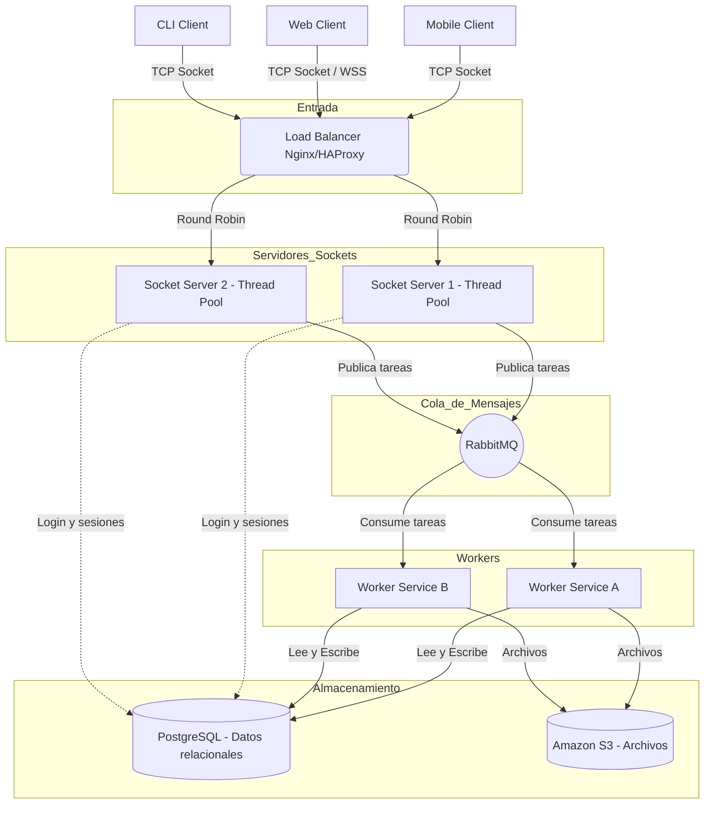
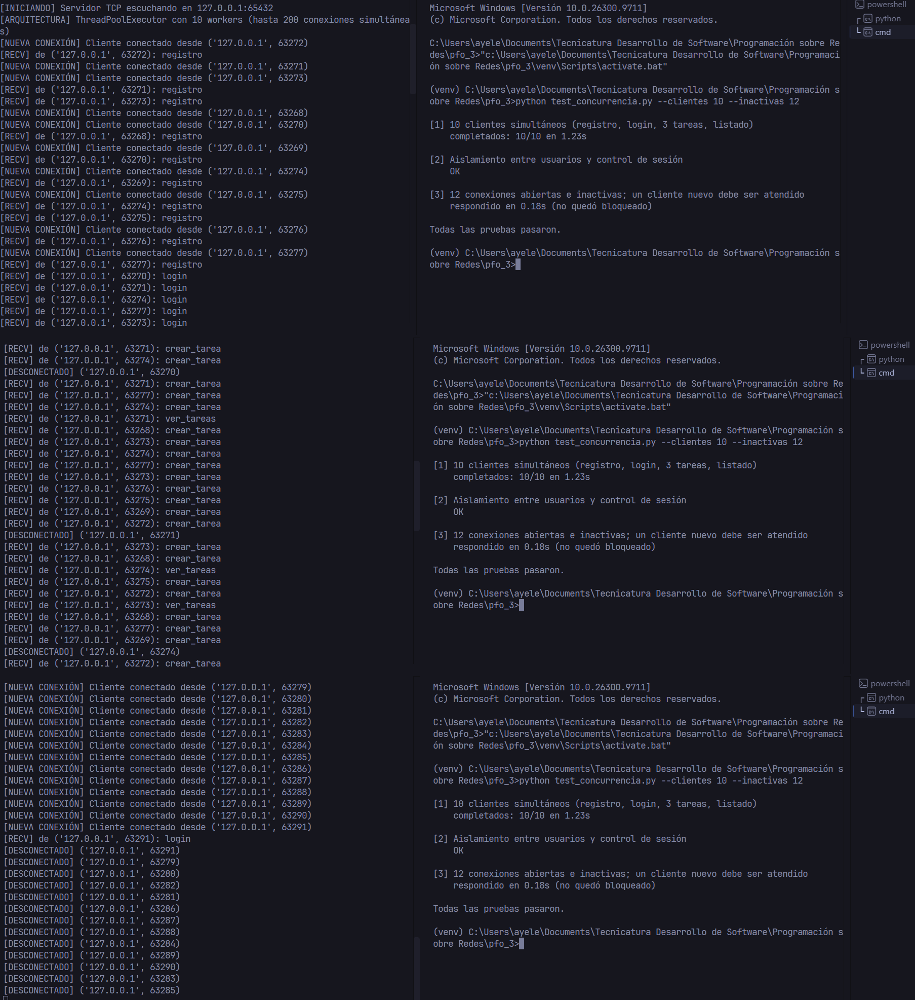

# PFO 3 – Sistema Distribuido de Gestión de Tareas (Sockets)

Este proyecto es la evolución de la PFO 2. Se migró de una API REST monolítica a una **Arquitectura Cliente-Servidor Distribuida** que usa sockets TCP en Python, un pool de hilos para la concurrencia y un diseño pensado para integrarse con colas de mensajes (RabbitMQ) y almacenamiento distribuido (PostgreSQL/S3).

## Arquitectura del Sistema

El diagrama muestra la **arquitectura objetivo**. La tabla siguiente aclara qué parte está implementada en este prototipo y cuál es conceptual.

| Componente | Estado en este repositorio |
|---|---|
| Servidor socket multihilo con `ThreadPoolExecutor` | ✅ Implementado (`servidor.py`) |
| Cliente de consola por sockets | ✅ Implementado (`cliente.py`) |
| Protocolo propio (longitud + JSON) | ✅ Implementado |
| Autenticación con token de sesión | ✅ Implementado |
| Hash de contraseñas (`werkzeug.security`) | ✅ Implementado |
| Persistencia | ⚠️ SQLite (en producción: PostgreSQL) |
| Balanceador de carga (Nginx/HAProxy) | 📐 Conceptual: el servidor admite `--puerto` para correr varias instancias |
| RabbitMQ y Workers consumidores | 📐 Conceptual: marcado con comentarios `NOTA ARQUITECTURA` en el código |
| Amazon S3 | 📐 Conceptual |

> En el prototipo el servidor socket accede directamente a la base de datos. En el diagrama objetivo, las escrituras pesadas pasarían por RabbitMQ y las harían los Workers.

### Diagrama de Flujo



## Protocolo de comunicación

TCP entrega un flujo de bytes sin límites entre mensajes. Por eso cada mensaje se envía así:

```
[ 4 bytes: longitud N (big-endian) ][ N bytes: JSON en UTF-8 ]
```

Acciones disponibles (`{"accion": ..., "datos": {...}}`):

| Acción | Datos | Requiere token |
|---|---|---|
| `registro` | `usuario`, `password` | No |
| `login` | `usuario`, `password` → responde `token` | No |
| `crear_tarea` | `token`, `descripcion` | Sí |
| `ver_tareas` | `token` | Sí |
| `logout` | `token` | Sí |

Respuesta: `{"status": "success" | "error", "mensaje": "...", ...}`. Si el token es inválido o expiró, además incluye `"sesion_invalida": true`.

## Estructura del Proyecto

```
redes_pfo3/
├── servidor.py             # Servidor TCP multihilo (hilo por conexión + pool de workers)
├── cliente.py              # Cliente de consola interactivo (socket TCP)
├── test_concurrencia.py    # Prueba de concurrencia y seguridad (reproduce la captura)
├── requirements.txt        # Dependencias (werkzeug)
├── capturas/               # Capturas de las pruebas
├── docs/
├── database.db             # Generada automáticamente por el servidor (no se sube a git)
└── README.md
```

## Instalación y ejecución

1. **Clonar el repositorio**

   ```bash
   git clone https://github.com/ayecristi/redes_pfo3.git
   cd redes_pfo3
   ```
2. **Crear y activar un entorno virtual** *(recomendado)*

   ```bash
   python -m venv venv
   source venv/Scripts/activate      # Windows (Git Bash)
   # o: venv\Scripts\activate        # Windows (CMD/PowerShell)
   ```
3. **Instalar dependencias**

   ```bash
   pip install -r requirements.txt
   ```
4. **Ejecutar el servidor.** Crea la base de datos automáticamente y escucha en `127.0.0.1:65432`.

   ```bash
   python servidor.py
   # Opciones: --host 0.0.0.0  --puerto 65433  --workers 10  --db otra.db
   ```
5. **Ejecutar el cliente** (en otra terminal, con el entorno activado)

   ```bash
   python cliente.py
   # Opciones: --host 127.0.0.1  --puerto 65432
   ```

## Pruebas de Funcionamiento

### Concurrencia con ThreadPool (Sockets)

Con el servidor corriendo, en otra terminal:

```bash
python test_concurrencia.py --clientes 10 --inactivas 12
```
> `--inactivas 12` supera la cantidad de workers (10) a propósito: demuestra que las conexiones abiertas sin actividad no bloquean al servidor.

El script ejecuta tres fases:

1. **Concurrencia:** N clientes simultáneos hacen registro, login, creación de 3 tareas y listado, cada uno por su propia conexión.
2. **Seguridad:** sin token o con un token falso se rechaza el acceso, un usuario no ve las tareas de otro y `logout` invalida el token.
3. **Conexiones inactivas:** con más conexiones abiertas que workers, un cliente nuevo igual es atendido.


> `--inactivas 12` supera la cantidad de workers (10) a propósito: demuestra que las conexiones abiertas sin actividad no bloquean al servidor.

## Seguridad y limitaciones conocidas

- **Autenticación por token:** `login` devuelve un token aleatorio (`secrets.token_urlsafe`) que se guarda en la tabla `sesiones` con vencimiento de 1 hora. El servidor deduce el usuario a partir del token y nunca confía en un identificador enviado por el cliente. Al estar en la base compartida, la sesión es válida aunque el cliente se reconecte a otra instancia.
- **Sin cifrado de transporte:** las contraseñas viajan en claro por el socket. El hash protege lo almacenado, no lo transmitido. En producción habría que usar TLS (en el balanceador o con el módulo `ssl`).
- **SQLite:** admite poca concurrencia de escritura entre procesos. Para varias instancias reales se migra a PostgreSQL.
- **Sin límite de intentos de login:** un entorno real debería agregar rate limiting.

## Fundamentos Teóricos del Prototipo

### ¿Por qué hashear contraseñas?

Guardar contraseñas en texto plano implica que, ante una filtración de la base de datos, todas las cuentas quedan comprometidas al instante. Un **hash** es una función de un solo sentido: a partir de la contraseña se obtiene una cadena irreversible. Se utiliza `werkzeug.security`, que agrega un **salt** aleatorio, de modo que dos usuarios con la misma contraseña tienen hashes distintos, lo que dificulta los ataques con tablas precalculadas (*rainbow tables*). Además, el servidor verifica un hash de relleno cuando el usuario no existe, para que el login tarde lo mismo y no permita descubrir qué cuentas existen.

### Uso de SQLite en este entorno de desarrollo

Si bien el diagrama arquitectónico apunta a PostgreSQL para un entorno distribuido real, este prototipo utiliza SQLite por las siguientes ventajas para su evaluación:

- **Base embebida, sin servidor de base de datos:** es un único archivo local (`database.db`); no requiere levantar contenedores ni configurar motores externos.
- **Nativo y portable:** el módulo `sqlite3` viene en la biblioteca estándar de Python. El proyecto se clona y funciona inmediatamente.
- **Cumplimiento ACID:** soporta transacciones y restricciones de integridad, lo que permite demostrar la persistencia sin complicar la infraestructura local.

### De Monolito REST a TCP Sockets

En la PFO 2 la comunicación se basaba en HTTP (arquitectura REST), un protocolo de aplicación sin estado. Al migrar a sockets TCP se define un protocolo de aplicación propio: se elimina la sobrecarga de los encabezados HTTP y se tiene control total del flujo de datos. La contrapartida es que ahora hay que resolver a mano lo que HTTP ya resolvía, como la **delimitación de mensajes** (TCP es un flujo de bytes), la sesión (ya no hay cookies, se usa un token) y los errores de red. Las conexiones persistentes no son exclusivas de TCP crudo, porque HTTP/1.1 también las admite; lo que cambia es el control sobre el protocolo.

### Concurrencia y Thread Pools

Un servidor socket básico procesa las conexiones de forma secuencial: se bloquea en `accept()` o en la lectura de datos, por lo que no podría atender a un segundo cliente hasta que el primero se desconecte. Una primera mejora es entregar cada conexión a un hilo del `ThreadPoolExecutor`, pero eso tiene un límite: la conexión ocupa el worker mientras esté abierta, aunque el cliente no esté haciendo nada. Con 10 workers, el cliente 11 queda esperando, y 10 conexiones inactivas bloquean todo el servidor.

Por eso este prototipo separa dos responsabilidades:

- **Un hilo liviano por conexión** que solo lee y escribe mensajes (y cierra la conexión tras 60 segundos de inactividad).
- **El `ThreadPoolExecutor`** que ejecuta las peticiones. Limita cuánto trabajo se procesa en paralelo, y una conexión inactiva ya no consume un worker.

El hilo principal queda libre para seguir aceptando clientes, y al apagar el servidor (Ctrl+C) las conexiones abiertas no impiden que el proceso termine.
