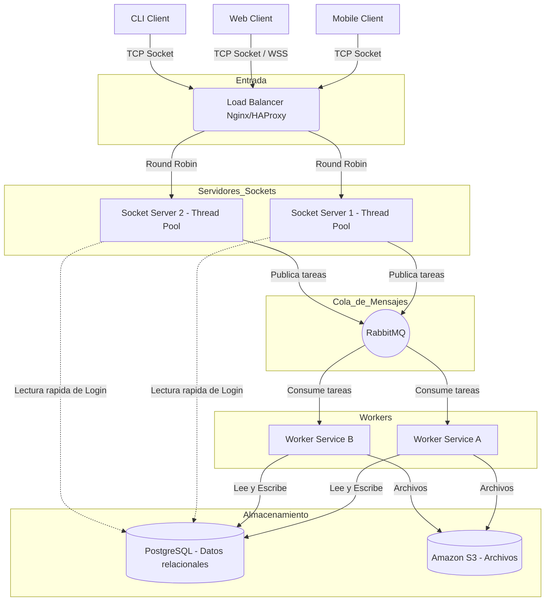

# PFO 3 – Sistema Distribuido de Gestión de Tareas (Sockets)

Este proyecto es la evolución de la PFO 2. Hemos migrado de una API REST monolítica a una **Arquitectura Distribuida Cliente-Servidor** utilizando sockets TCP crudos en Python, Thread Pools para concurrencia y un diseño preparado para integrarse con colas de mensajes (RabbitMQ) y almacenamiento distribuido (PostgreSQL/S3).

## Arquitectura del Sistema

El sistema implementa:
- **Load Balancer (conceptual):** Preparado para distribuir tráfico entre múltiples instancias del servidor socket.
- **Servidor Socket Multihilo:** Utiliza `ThreadPoolExecutor` para manejar conexiones de múltiples clientes en paralelo sin bloquear el hilo principal.
- **Protocolo de Comunicación:** Los clientes y el servidor se comunican intercambiando payloads en formato JSON sobre TCP.
- **Seguridad y Persistencia:** Se mantiene el hashing de contraseñas y el almacenamiento local para facilitar el despliegue del prototipo.

### Diagrama de Flujo



## Estructura del Proyecto

```text
redes_pfo3/
├── servidor.py          # Servidor TCP multihilo (maneja pool de workers)
├── cliente.py           # Cliente de consola interactivo (Socket TCP)
├── requirements.txt     # Dependencias (werkzeug)
├── database.db          # Generada automáticamente por el servidor
└── README.md
```

## Instalación y ejecución

1. **Clonar el repositorio**
   ```bash
   git clone [https://github.com/ayecristi/redes_pfo3.git](https://github.com/ayecristi/redes_pfo3.git)
   cd redes_pfo3
   ```
2. **Crear y activar un entorno virtual** *(recomendado)*
   ```bash
   python -m venv venv
   source venv/Scripts/activate      # Windows (Git Bash)
   # o: venv\Scripts\activate        # Windows (CMD/PowerShell)
   ```
3. **Instalar dependencias**
   ```bash
   pip install -r requirements.txt
   ```
4. **Ejecutar el servidor**
   Al iniciarse, el servidor levantará la base de datos automáticamente y quedará escuchando conexiones entrantes en el puerto `65432`.
   ```bash
   python servidor.py
   ```
5. **Ejecutar el cliente** (en una nueva terminal, con el entorno activado)
   ```bash
   python cliente.py
   ```

## Pruebas de Funcionamiento

### Concurrencia con ThreadPool (Sockets)
A continuación se demuestra el servidor atendiendo múltiples conexiones TCP entrantes en paralelo, procesando peticiones de registro, login y creación de tareas desde distintos clientes de manera concurrente.


## Fundamentos Teóricos del Prototipo

### ¿Por qué hashear contraseñas?
Guardar contraseñas en texto plano implica que, ante una filtración de la base de datos, todas las cuentas quedan comprometidas al instante. Un **hash** es una función de un solo sentido: a partir de la contraseña se obtiene una cadena irreversible. Se utiliza `werkzeug.security`, el cual agrega un **salt** aleatorio, de modo que dos usuarios con la misma contraseña tienen hashes distintos, dificultando los ataques con tablas precalculadas (*rainbow tables*). 

### Uso de SQLite en este entorno de desarrollo
Si bien el diagrama arquitectónico apunta a PostgreSQL para un entorno distribuido real, este prototipo en código utiliza SQLite por las siguientes ventajas para su evaluación:
- **Sin servidor (Serverless):** La base es un único archivo local (`database.db`); no requiere levantar contenedores ni configurar motores externos.
- **Nativo y portable:** El módulo `sqlite3` viene en la biblioteca estándar de Python. El proyecto se clona y funciona inmediatamente.
- **Cumplimiento ACID:** Soporta transacciones y restricciones de integridad estándar, siendo ideal para demostrar la persistencia de los *workers* sin complejizar la infraestructura local.

### De Monolito REST a TCP Sockets
En versiones anteriores, la comunicación se basaba en HTTP (arquitectura REST), un protocolo sin estado de alto nivel. Al migrar a **Sockets TCP crudos**, el sistema establece conexiones persistentes y bidireccionales de bajo nivel. Esto reduce la sobrecarga de los encabezados HTTP y permite un control granular sobre el flujo de datos (paquetes JSON), sentando las bases para una comunicación interna eficiente entre los microservicios y *workers* del entorno distribuido.

### Concurrencia y Thread Pools
Un servidor socket básico procesa las conexiones de forma secuencial, bloqueando el hilo principal en `server.accept()` o durante la lectura de datos, lo que impediría atender a un segundo cliente hasta que el primero se desconecte. Para solucionar esto y soportar la carga concurrente esperada en el diagrama de arquitectura, se implementó un **ThreadPoolExecutor**. Esta estructura mantiene un *pool* de hilos (workers) pre-creados; cuando ingresa una conexión, se asigna inmediatamente a un hilo disponible, permitiendo que el hilo principal vuelva a escuchar el puerto instantáneamente para recibir nuevos clientes en paralelo.